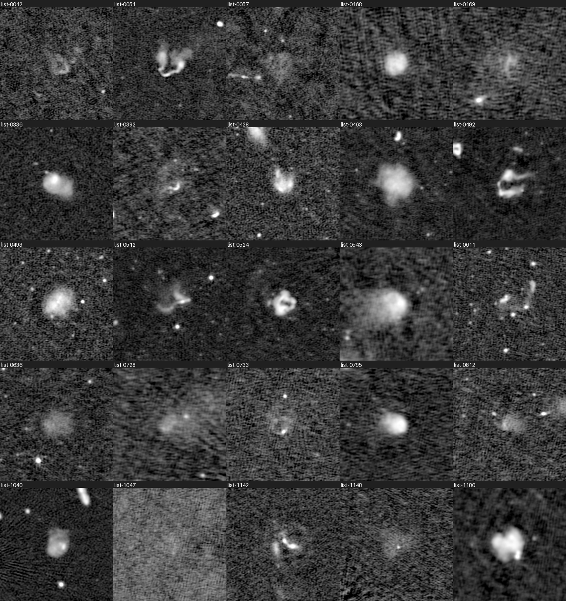
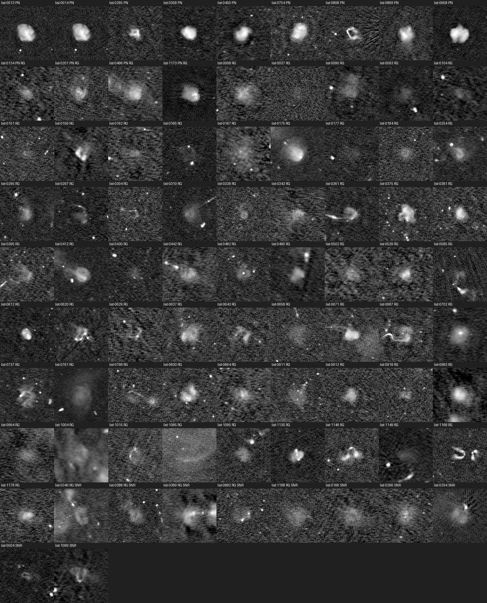
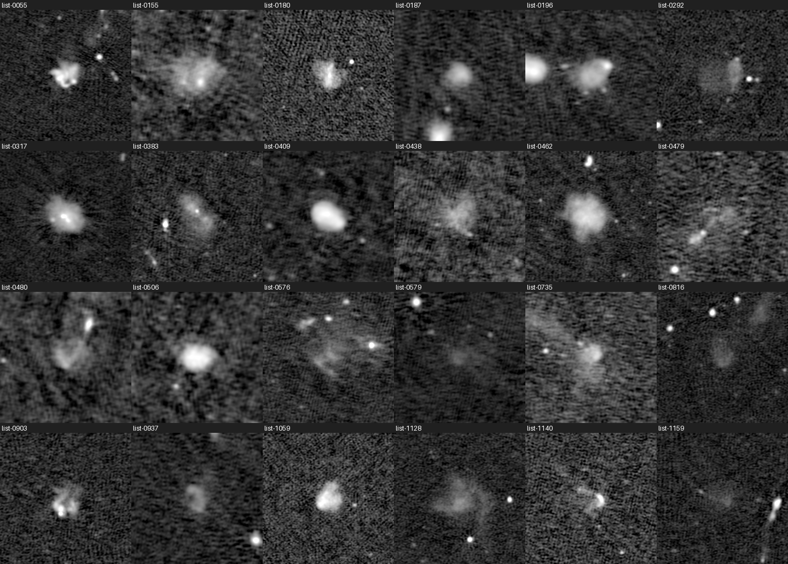
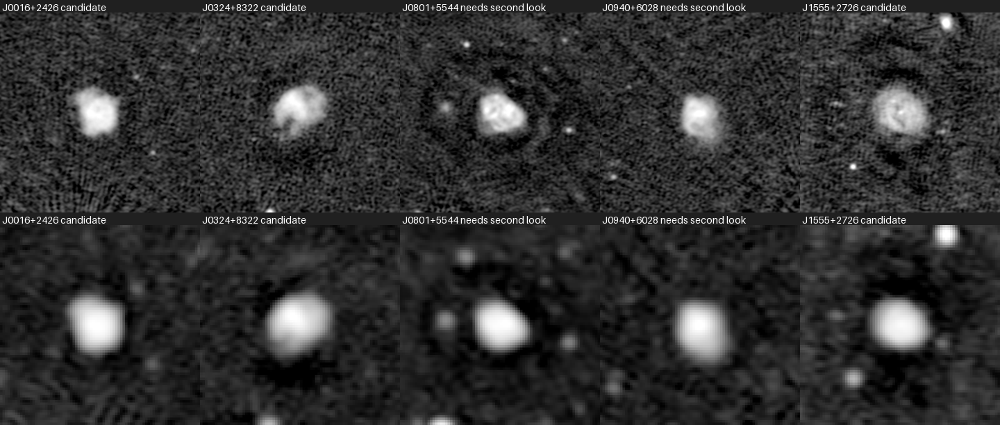

# Odd radio circles

A blind search of public LOFAR radio maps for odd radio circles, using Meta's vision models to screen for rings and code to check the physics.

Odd radio circles are faint rings of radio emission about an arcminute across, seen only at radio wavelengths, with no agreed explanation. This project screens sources from the LOFAR Two-metre Sky Survey (LoTSS DR3) with Muse Wonder, checks each ring-like source against known classes of lookalike in code, and reports how many of the 18 published LoTSS circles it recovers end to end. Results are candidates or needs second look, never discoveries.

## Results

<!-- figures: written by scripts/readme_figures.py from verdicts.json and summary.json -->
**The rows the search left, as pictures.** Each tile is a reduced copy of the LoTSS DR3 map Wonder voted on, 6 arcmin
on a side at the 6 arcsec resolution, labelled with the row's id on the [case board](docs/reports/2026-11-01-case-board/board.html), where the
full-size maps at both resolutions, the votes, reasons and cross-match are. Candidate is a screening grade. It says the code checks passed and Wonder called the row ring-like twice. It does not say the row is a ring. Nothing in these figures has
been followed up at other wavelengths.

**Figure 1. The 25 candidate rows, of 108, with no class Wonder named on either vote.** These
have the least against them: the code checks passed, two ring-like votes, and no class named. The report's reading of
this panel by eye, which grades nothing, is that many are filled discs or bent doubles rather than rings, and a few have
open or edge-bright shapes.

**Figure 2. The other 83 candidate rows, with the class Wonder named on a vote** (RG radio galaxy, PN planetary
nebula, SNR supernova remnant; 69 rows carry RG). A named class moves no verdict under the board's rule. It is shown
because it is the main reason to doubt the row.

**Figure 3. The 24 needs second look rows.** The code checks passed and the first vote was ring-like, and the
second vote was not ring-like or did not arrive. A real ring that Wonder doubted once would sit here.

**Figure 4. The 5 known circles, of 18, that reached the board,** with the 6 arcsec map (top) and the 20 arcsec
map (bottom) at the published position, and the grade their rows took: 3 at candidate grade and
2 at needs second look. They are the control for the grade, and the only published rings on
these pages. The other 13 ended before the board,
12 of them at the pre-filter; the [circles page](docs/reports/2026-11-01-case-board/circles.html) shows each.

Figures drawn by `scripts/readme_figures.py` from `docs/reports/2026-11-01-case-board/verdicts.json` and the board's maps; what each panel holds
is in `docs/reports/2026-11-01-case-board/figures/figures.json`.
<!-- end of figures -->

<!-- results: written by scripts/case_board.py from its summary.json -->
**End to end, known circles, each counted once of 18 (95 percent Wilson intervals, from `docs/reports/2026-11-01-case-board/summary.json`):**

| stage | circles |
|---|---|
| on the pre-filter list of 1200 rows | 6 of 18 (95 percent interval 0.16 to 0.56) |
| and a ring-like first vote from Wonder | 5 of 18 (95 percent interval 0.13 to 0.51) |
| and left by the known-object cuts | 5 of 18 (95 percent interval 0.13 to 0.51) |
| and a row at candidate grade (two ring-like votes) | 3 of 18 (95 percent interval 0.06 to 0.39) |

Most of the loss is at the pre-filter, which ended 12 of the 18. These rates are not blind: the prompt and
the pre-filter's cuts were tuned with known circles in view. At candidate grade, by group:
3 of 9 (95 percent interval 0.12 to 0.65) tuning, 0 of 9 (95 percent interval 0.00 to 0.30) held-out. The
[circles page](docs/reports/2026-11-01-case-board/circles.html) shows where each was kept or lost.

**The search, in rows.** The money stopped at the plan's limit of 36 USD (35.97 USD on the ledger over all runs),
so Wonder voted on 934 of the 1200 rows, and 200 of those were
called ring-like. Without known circles' rows:

| verdict | rows |
|---|---|
| candidate | 108 |
| needs second look | 24 |
| likely known class | 61 |
| not assessed | 266 |

A further 733 other rows had a not-ring-like first vote and take no verdict. The candidate and needs
second look rows are 132 rows and 130 objects when rows within 3 arcmin are
linked, and each has its maps, votes and cross-match on the [case board](docs/reports/2026-11-01-case-board/board.html).

**Candidate is a screening grade. It says the code checks passed and Wonder called the row ring-like twice. It does not say the row is a ring.** Most candidates may not be rings: no cut looks for radio galaxies, and 83 of the 108
candidate rows carry a class Wonder named on a vote, 69 of them radio_galaxy. Had any named class lowered a
candidate, 25 rows would remain, and known circles at that grade would fall from 3 to
0 of 18. That is a count and moves no verdict. Nothing on the board has been followed up at other
wavelengths.

Sources: `docs/reports/2026-11-01-case-board/summary.json`, `docs/reports/2026-11-01-case-board/verdicts.json`, and the [report](docs/reports/2026-11-01-case-board.md).
<!-- end of results -->

## Before the search

Before building, the model was tested on known answers: Muse Wonder called 13 of 18 published circles ring-like and rejected 53 of 60 non-circles, where a simple ring-detection rule flagged none of the circles (`docs/reports/2026-10-31-probe-orc.md`). A zoomed view made no measurable difference (`docs/reports/2026-10-31-probe-orc-zoom.md`).

## Data and credit

LoTSS DR3: Shimwell et al. 2026, A&A 707, A198, with the acknowledgements at https://www.lofar-surveys.org/credits.html. Known circles: De Gasperin et al. 2026 (arXiv:2602.18294).

## Commands

    uv sync
    scripts/check.sh
