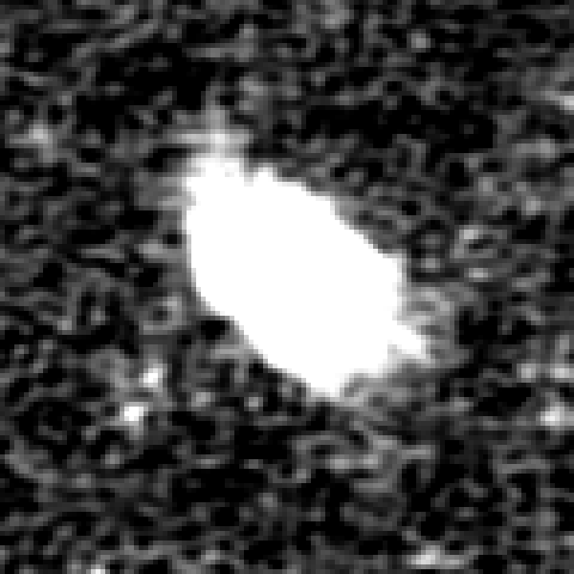
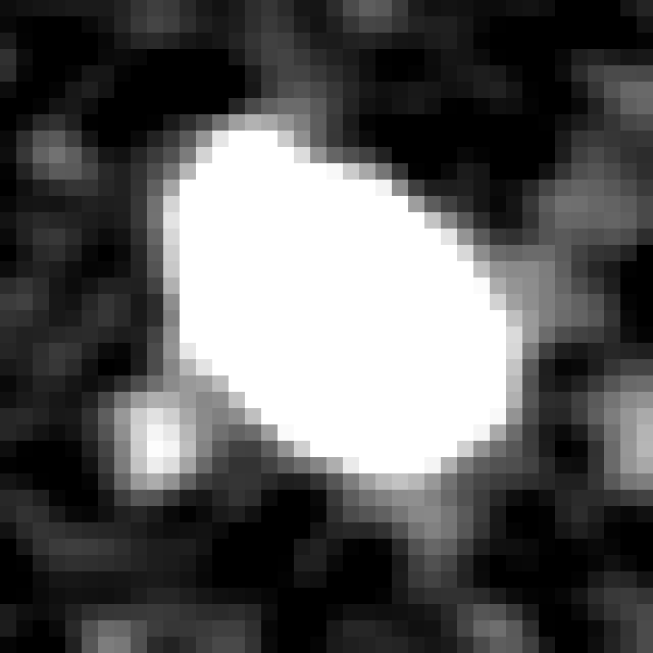
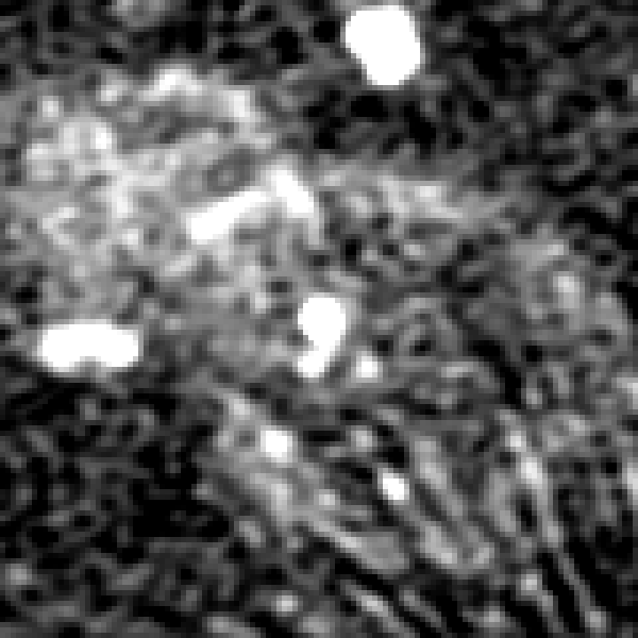
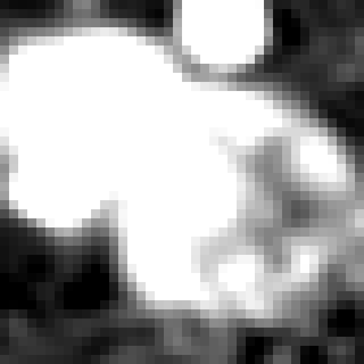
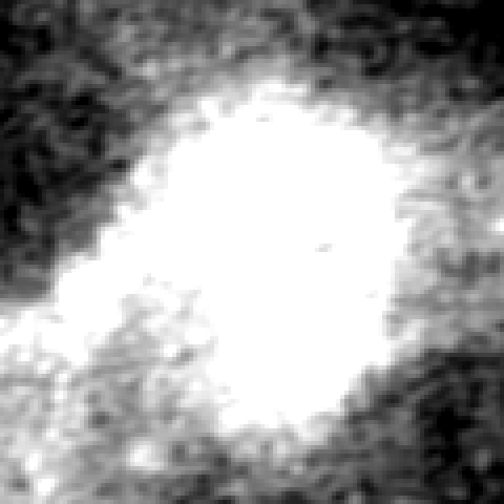
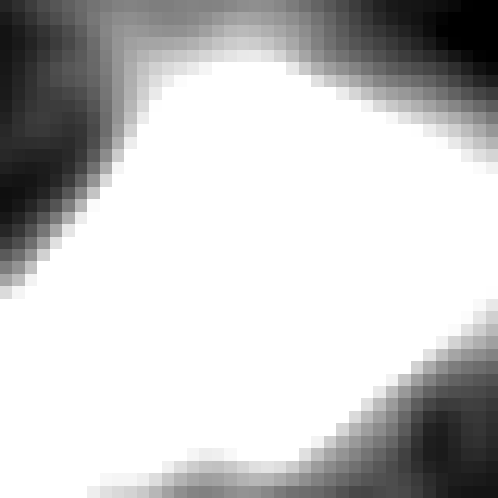
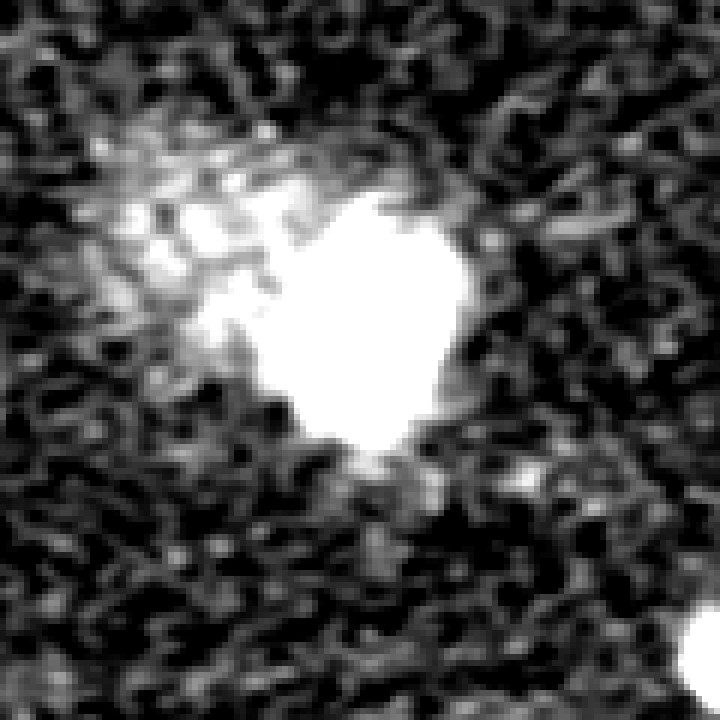
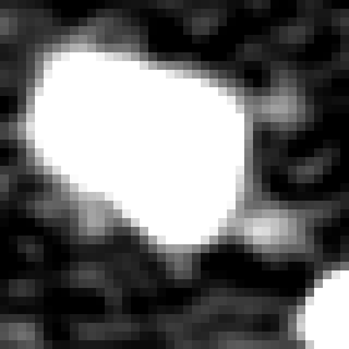
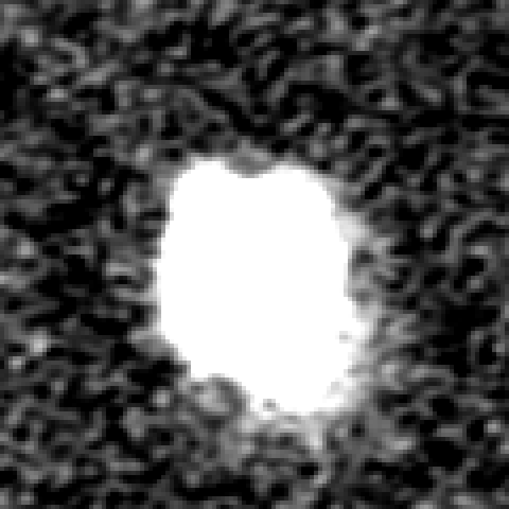
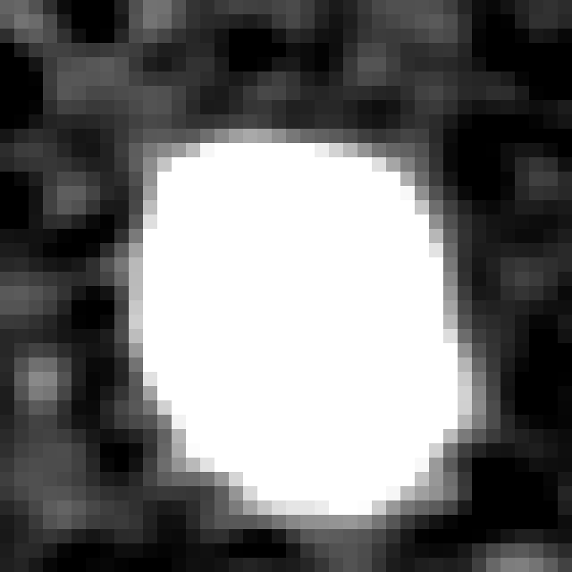

# Item 6, radio zoom test: bar not passed, and the zoom made no measurable difference

With the zoomed views added, Muse Wonder called 13 of the 18 circles ring-like, the same count as the first run, and the bar needs at least 14. It rejected 54 of the 60 others (0.90), against 53 before, which clears the bar's 80 percent. So the bar fails on its first half, by one field, as it did before.

Only 3 of the 78 answers changed: one circle gained, one circle lost and one ring galaxy now rejected. This single run cannot separate those three from ordinary run-to-run variation, which has not been measured. The evidence does not show that the small size of the circles in the image was what held the model back. It does not rule that out either, because the stretch used here also has a weakness, described below.

All counts come from the runner's files in [2026-10-31-probe-orc-zoom/](2026-10-31-probe-orc-zoom/), mostly `comparison.json`. Every call answered, each carried all four images, and there were no failures or off-schema answers.

## Results

| run | circles called ring-like (bar: at least 14 of 18) | 95 percent interval | others rejected (bar: at least 48 of 60) | 95 percent interval | all fields | 95 percent interval |
|---|---|---|---|---|---|---|
| Muse Wonder, with zoom | 13 of 18 (0.7222) | 0.4913 to 0.875 | 54 of 60 (0.90) | 0.7985 to 0.9534 | 67 of 78 (0.859) | 0.7649 to 0.9194 |
| Muse Wonder, first run | 13 of 18 (0.7222) | 0.4913 to 0.875 | 53 of 60 (0.8833) | 0.7782 to 0.9423 | 66 of 78 (0.8462) | 0.7501 to 0.9097 |
| annulus score, same maps | 0 of 18 | 0 to 0.1759 | 55 of 60 (0.9167) | 0.8193 to 0.9639 | 55 of 78 (0.7051) | 0.5962 to 0.7948 |

Confusion table for the zoom run (rows are labels):

| label | not_ring_like | ring_like |
|---|---|---|
| not_ring_like | 54 | 6 |
| ring_like | 5 | 13 |

Circles called ring-like:

| circles | zoom run | first run |
|---|---|---|
| all | 13 of 18 | 13 of 18 |
| confirmed | 7 of 9 | 7 of 9 |
| candidates | 6 of 9 | 6 of 9 |
| tuning list | 6 of 9 | 6 of 9 |
| held-out list | 7 of 9 | 7 of 9 |

Others rejected, by group:

| group | zoom run | first run |
|---|---|---|
| ring galaxies | 4 of 6 | 3 of 6 |
| planetary nebulae | 3 of 6 | 3 of 6 |
| supernova remnants | 5 of 6 | 5 of 6 |
| radio galaxies | 6 of 6 | 6 of 6 |
| artefact rings | 6 of 6 | 6 of 6 |
| random sources | 30 of 30 | 30 of 30 |

## Answers that changed

Three changed: two became right and one became wrong. Both reasons for each are in [changes.md](2026-10-31-probe-orc-zoom/changes.md).

| object | label | first run | zoom run | reason in the zoom run, shortened |
|---|---|---|---|---|
| J0320+1610 (held-out candidate) | ring-like | not ring-like | ring-like, now right | a round disc 1 to 2 arcmin across, "persisting in the hard-stretch zooms" |
| J0940+6028 (held-out candidate) | ring-like | ring-like | not ring-like, now wrong | an irregular blob "saturated in the zoomed views", with no ring or edge |
| NGC 7217 (ring galaxy) | not ring-like | ring-like | not ring-like, now right | a compact source whose saturated halo is no real ring |

## Circles still missed

Five of the 18 are missed: three candidates and two confirmed double-headed circles. Four of them were also missed in the first run. J0940+6028 is new, and J0320+1610 is no longer missed. In each pair below, the 6 arcsec view is on the left and the 20 arcsec view on the right. The model's reasons are in [wrong.md](2026-10-31-probe-orc-zoom/wrong.md).

**J1313+5003, confirmed double-headed circle.** The model called it an elongated filled ellipse.

 

**J0847+7022, confirmed double-headed circle.** The model called it an irregular filled patch with embedded sources.

 

**J1436+4832, candidate.** The model called it an irregular elongated cloud.

 

**J1608+6123, candidate.** The model called it amorphous, about 1 arcmin across.

 

**J0940+6028, candidate.** The model called it a filled, slightly elongated blob, and cited the saturation.

 

By my own viewing, J1313+5003, J1608+6123 and J0940+6028 are bright blobs that go solid white in these views, and J1436+4832 fills most of its 20 arcsec view. J0847+7022 is a patchy complex with what look like imaging stripes at the lower right of its 6 arcsec view. None of the five shows a ring here, so the model's descriptions of them fit what these views show.

## Weaknesses that bear on the verdict

- **The stretch saturates bright objects.** White starts at 5 sigma, so a bright disc goes solid and any ring or edge inside it is lost. This view shows faint emission better and bright structure worse, and the model cited that saturation when it dropped J0940+6028. The first run's two views were still sent, and they keep the brighter structure.
- **Saturation does not clearly separate the misses from the hits.** The median white fraction of the 20 arcsec zoom is 0.284 for the 5 missed circles and 0.223 for the 13 called, and for the 6 arcsec zoom 0.095 against 0.042. With so few fields, this neither shows that saturation caused the misses nor clears it. A softer stretch was not tried, because the item fixes one stretch before the run.
- **One run, one setting.** Each field was asked once at the fixed low effort, as in the first run, and run-to-run variation was never measured. If asking twice would flip a few answers anyway, all three changes could be chance.
- **The comparison changes two things at once.** The zoom and the stretch arrived together, in the same added images, so this run cannot credit or blame either one alone.
- **The first run's weaknesses carry over.** The prompt was tuned on the circles, including the held-out ones, so 7 of 9 on that list is not an independent test. The lookalikes and the labels are the same, and several labels are doubtful, as the [first report](2026-10-31-probe-orc.md) says. At 13 of 18 the interval still includes the 0.78 the bar asks for.
- **Some reasons are poor, though the answers are valid and were counted as given.** The NGC 3587 reason opens with unrelated medical text ("diagnosing myalgic encephalomyelitis..."). The NGC 4736 reason is general filler. The reason for one random field says "just noise, no ORC etc.", so the model used the term for these objects, though the prompt never does. That shows it knows the class, not that it knows any one object. The recognition check was not repeated, because the item did not ask for it.

## How the views were fixed

The crop and stretch are constants in `probe/radio.py`, described in `docs/probes.md` and committed in `51f26b2` before the paid call. They use only each map's own median and noise, measured over its whole 6 arcmin field, and no object's size or class. I set them before drawing any zoomed view. Before the run I looked at the two zoomed views of one random field and at brightness figures for all 156 views, to confirm the drawing worked, and changed nothing. I saw the zoomed views of the missed circles only after the run.

All 78 fields, on both maps, redraw byte for byte into the first run's images, so the added views come from the same pixels (the script stops otherwise). Nothing was downloaded. The prompt differs from the first run's only in "The first two images" for "These two images", and in one added paragraph saying what the third and fourth images are; a test holds this. The schema, its name and the bar are unchanged, and the annulus score is the first run's. There was no fake-backend run on these fields, though the new tests use the fake backend on synthetic images.

## Cost

This run cost 2.7679 USD on the ledger, under its stop of 4 USD, bringing the shared ledger to 6.7601 USD of the 10 USD cap (`ledger.json`). The ledger charges the floor of 1,500 tokens per image, so 6,000 per call, and the API reported 2,798 per call (`comparison.json`), so the ledger overstates what the API reported. Neither figure has been compared with a bill.

The landers cumulative register, `../finding-landers/docs/reports/ledgers.json`, has no row naming this project, so its total does not include this project's 6.76 USD, although both spend one credit. I did not change that file, which belongs to the other project.

## Checks

`scripts/check.sh` and `scripts/leakcheck.sh` pass: 112 tests, ruff and the prompt check. The guard passed the prompt, the schema name and every image at run time. No item ID appears in any request in `records.jsonl`, and the key appears in no `.md`, `.json` or `.jsonl` file under `docs/` and not in `records.jsonl`.

Three commands were denied in this unattended session, and none affected a result. They were two read-only look-arounds, written with a shell variable and with `git -C`, and one inline script making edits, which I redid with the edit tool. I reran the read-only checks in another form.
